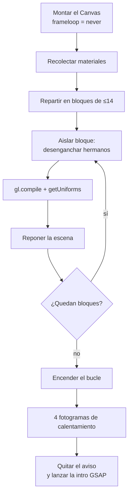
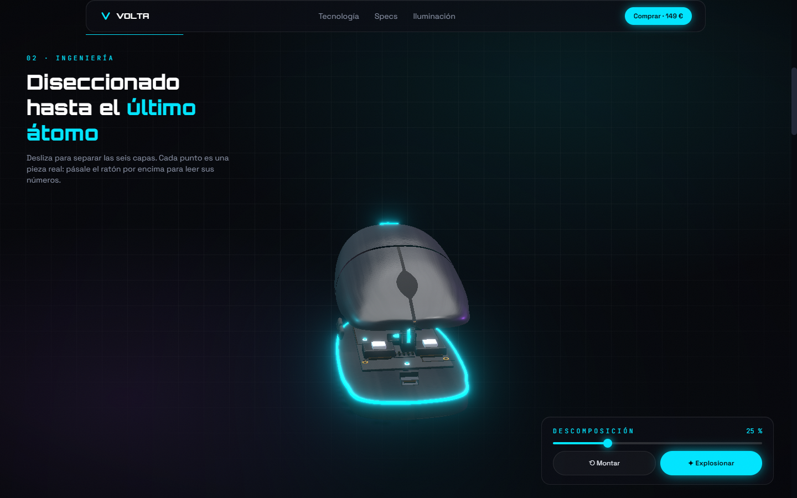

# Caso de estudio: de 2,9 s de congelación a 60 fps estables

**VOLTA X1** es una landing de producto ficticia con un ratón 3D renderizado en
tiempo real. La escena se descompone capa a capa con el scroll, gira con el
arrastre y abre fichas técnicas en hotspots anclados a cada pieza.

- **En vivo:** https://alejandropd05.github.io/volta-x1/
- **Código:** https://github.com/AlejandroPD05/volta-x1
- **Stack:** React 19, React Three Fiber, three.js, postprocessing, GSAP,
  Framer Motion, Zustand y Vite.


## El problema

La primera versión funcionaba, pero al cargar se quedaba congelada varios
segundos y el scroll del despiece daba tirones. Además, al cambiar el acento de
color o al mover el ratón aparecía un parpadeo blanco.

El objetivo no era “optimizar por optimizar”: había que mantener **el mismo
aspecto y las mismas animaciones**, y llegar a 60 fps estables también durante
el despiece y el postprocesado. Cualquier cambio que se notara en pantalla
quedaba descartado.

## Cómo se midió

Las mediciones se hicieron con **Chromium en modo headed** (GPU real, sin el
renderizador software de headless), con flags para que el navegador no
estrangulase las pestañas en segundo plano:

- `requestAnimationFrame` para fps y percentil 95 del tiempo de fotograma.
- `PerformanceObserver` para las tareas largas del hilo principal.
- Para el parpadeo, muestreo del búfer del canvas fotograma a fotograma
  (parcheando `getContext` con `preserveDrawingBuffer`), contando cambios de
  tamaño del lienzo y fotogramas en blanco.

Todos los scripts de medición eran temporales y se borraron al terminar.

## Diagnóstico: el coste no estaba donde parecía

El perfilador señaló al arranque de los shaders, no al número de mallas:

| Dato medido | Valor |
| --- | --- |
| Materiales de la escena | 168 |
| Programas GL únicos | 13 |
| Trabajo JS de `gl.compile()` con 168 materiales | ~700 ms |
| Reflexión de uniformes de los 13 programas | ~1.460 ms |
| Coste de un programa en Windows/ANGLE | ~150 ms |
| Tarea más larga del arranque original | **2.890 ms** |

La causa: cada `<meshStandardMaterial>` del JSX es una instancia distinta. Three
deduplica los programas por clave de caché, pero `compile()` recorre y prepara
los 168 materiales uno a uno. Peor aún, cada consulta síncrona a la GPU
(`getProgramParameter`, `getUniforms`) espera a que el driver termine la cola
que tenga pendiente. Con la cola llena, preguntar bloquea el hilo principal.

`compileAsync()` no era la solución: su sondeo en bucle hacía **~2.400
consultas de `getProgramParameter`** y bloqueaba la página ~2,5 s. Se descartó
tras medirlo.

## La solución: compilar por bloques con la cola corta

El precompilado vive en `src/escena/precompilar.ts` y funciona así:

1. **Recolecta** los objetos pintables y sus materiales.
2. **Reparte la escena en bloques de 14 materiales como máximo**, partiendo por
   la jerarquía. Los subárboles que contienen luces no se parten: hacen falta
   para calcular los shaders y no se pueden desenganchar.
3. **Aísla cada bloque** desenganchando a sus hermanos del grafo (no ocultando
   subárboles). Es importante porque `gl.compile()` usa `scene.traverse`, no
   `traverseVisible`: lo que no está en el grafo no se compila.
4. **Compila el bloque** con `gl.compile(scene, camera)` y lo vuelve a enganchar.
5. **Fuerza el enlace y la reflexión** de cada programa nuevo con
   `program.getUniforms()`. Con la cola del driver todavía corta, el bloqueo es
   de ~130 ms en lugar de arrastrar toda la cola.
6. **Cede el hilo** con `setTimeout(0)` entre bloques.



El resultado ya no es una sola tarea de 2,9 s: el trabajo se reparte en tramos
de ~40-80 ms de JavaScript y ~130 ms de reflexión, con respiro entre bloques.
La interfaz, el cursor y el scroll siguen respondiendo mientras la GPU prepara
los programas.

### Arranque ordenado

- El `<Canvas>` monta con **`frameloop="never"`**: no se renderiza ni un
  fotograma hasta que los shaders están listos.
- `Compilador` llama al precompilado; `Calentador` espera 4 fotogramas para que
  también terminen de compilarse las pasadas del postprocesado y la sombra de
  contacto.
- Solo entonces se enciende el bucle y arranca la intro de GSAP. Antes, la
  intro se gastaba mientras la escena aún no se veía.
- Mientras tanto se muestra un aviso discreto: **“Preparando la escena 3D”**.
- En producción, `renderer.debug.checkShaderErrors = false` (en desarrollo se
  mantiene para ver los errores): `three` consulta el log de cada programa al
  crearlo y esa consulta también bloquea.

## Recortar el coste por fotograma

El arranque era el pico, pero el scroll seguía teniendo trabajo innecesario:

- **Cámara sin `clone()`**: se reutiliza un vector temporal en lugar de crear
  objetos cada frame.
- **Hotspots** con un rango Z constante y sin asignaciones por frame.
- **Cursor** con un `requestAnimationFrame` que se detiene cuando no hay
  movimiento.
- **`ControlExplosion`** lee el porcentaje con un selector redondeado, así no
  re-renderiza por cada decimal.
- **`MarcadoresHotspot`** agrupa las escrituras del DOM y solo escribe cuando
  cambia el valor.
- **Valores continuos fuera de React**: la simulación vive en un objeto mutable
  (`sim`) y la escena los lee en `useFrame`; no hay re-renders por frame.
- **`Antialias` fuera** y `stencil: false`: el postprocesado renderiza a sus
  propios targets; la bandera solo reservaba un búfer MSAA que nadie usaba.
- **Sombra de contacto horneada** (`frames={1}`) y rehorneada solo al detenerse
  en un tramo nuevo del despiece, con un debounce de 180 ms para no hornear los
  tramos intermedios de un scroll rápido.
- **Viñeta por CSS** (`.vineta`) en lugar de un pase de postprocesado: el mismo
  efecto, gratis para la GPU porque es estática y la pinta el compositor.
- **Sin `backdrop-filter`** en el cristal de la interfaz.
- **Texturas procedurales más pequeñas**: 256 → 160 y el panal 512 → 256.
- **`frameloop` apagado** cuando el pie de página tapa la escena: no se gasta
  ni un frame de más.
- **`dpr` fijo entre 1 y 1,25**.

## El parpadeo: un falso amigo llamado DPR adaptativo

El parpadeo no venía de los shaders. `AdaptiveDpr` y un “vigilante” propio
bajaban la resolución cuando la media de fotogramas superaba los 17 ms. Cada
cambio de `dpr` **redimensiona el lienzo y borra el búfer**: durante un
fotograma se ve el fondo blanco. En una GPU normal el ajuste no hacía falta y
en una lenta el tope fijo de 1,25 ya protege.

Se eliminaron ambos y se dejó un `dpr` fijo. Verificación posterior con
muestreo por fotograma:

- **1.342 fotogramas** analizados.
- **0 redimensionados** del lienzo tras la carga.
- **0 fotogramas en blanco**.
- Brillo mínimo registrado: 4,6 (el fondo oscuro normal, ni un destello).

## Lo que se descartó (con datos)

- **`compileAsync()`**: ~2.400 consultas síncronas y ~2,5 s de bloqueo. Peor que
  el problema.
- **Fusionar mallas**: la escena tiene 81 mallas, pero cada pieza tiene su
  propio color, rugosidad y metalicidad. La PCB genera 81 firmas distintas, así
  que fusionar solo ahorraba **8 draw calls** y cambiaba el aspecto. Se
  revirtió (`src/escena/partes/Parte.tsx` lo documenta).
- **`AdaptiveDpr` + vigilante**: causaban el parpadeo.
- **Pase de viñeta en postprocesado**: sustituido por CSS.
- **`prefers-reduced-motion`**: en Windows, la opción “Efectos de animación”
  solo llega como esta media query. VOLTA se limita a saltarse la intro y la
  rotación ociosa; no era la causa del parpadeo.

## Resultados

| Métrica | Antes | Después |
| --- | --- | --- |
| Tarea más larga al cargar | 2.890 ms | ~130 ms por reflexión, con cesiones entre bloques |
| Fps en scroll y despiece | con tirones | **159-165 fps** (monitor de 165 Hz) |
| Percentil 95 del fotograma | — | **6-8 ms** |
| Fotogramas perdidos (jank) | — | **0 %** |
| Cambios de resolución en caliente | en cada ajuste del DPR | **0** |
| Fotogramas en blanco | visibles al cambiar el DPR | **0** en 1.342 muestreados |

El objetivo eran 60 fps estables; la medición se hizo en un monitor de 165 Hz,
así que el margen es aún mayor: el percentil 95 queda muy por debajo de los
16,7 ms que exige un fotograma a 60 fps.



## Conclusiones

1. **Medir antes de tocar**: el cuello de botella no era el número de mallas ni
   el postprocesado, sino la compilación síncrona de programas y las consultas
   de estado a la GPU.
2. **El driver importa**: una consulta inocente como `getProgramParameter`
   puede costar cientos de milisegundos si la cola está llena. Hay que dejarla
   corta y consultar por bloques.
3. **La solución más “moderna” no siempre es la mejor**: `compileAsync()` era
   más lento que el problema que pretendía resolver.
4. **Optimizar no es quitar cosas**: la fusión de mallas se descartó porque
   ahorraba poco y cambiaba el aspecto. El límite era el resultado visual.
5. **El parpadeo también es rendimiento**: un ajuste adaptativo que parece una
   mejora puede introducir un defecto visible. La verificación por píxeles lo
   demuestra sin discusión.

## Reproducir

```bash
npm install
npm run dev      # desarrollo
npm run build    # type-check + bundle
npm run preview  # sirve el bundle de producción
npm run lint
npm test
```

Los cambios están en dos commits:

- [`e57cff8`](https://github.com/AlejandroPD05/volta-x1/commit/e57cff8) — arranque
  por bloques y coste por fotograma.
- [`e348881`](https://github.com/AlejandroPD05/volta-x1/commit/e348881) — retirada
  del DPR adaptativo que causaba el parpadeo.
